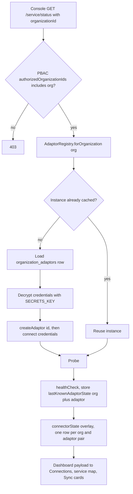

# Implementation Plan — Organization Onboarding Overhaul

**Item 1 of the onboarding workstream.** Install-time bootstrap plus per-organization configuration
of the payment-gateway and accounting-software connections.

**Branch:** `feat/org-onboarding` (from `main` at `c8ae4e1`).
**Estimate:** **41–60 engineer-days** core (~8.5–12 weeks solo, ~5–7 weeks with two engineers), plus
**3–5 days** for the organization switcher if multi-org users are in scope. See §12.

> **This is materially larger than the first estimate, and the reason matters.** The earlier 31–47 day
> figure assumed the adaptors took credentials as arguments. They do not: `QuickBooksAdaptor.connect()`
> reads `env.QUICKBOOKS_*` **directly**, the `AccountingAdaptor` interface has no credentials
> parameter, and the runtime connection state is a module-level `Map` keyed by adaptor id alone.
> Per-organization credentials are therefore an interface change plus a refactor of every consumer of
> that state — not a config table. §3 and §4 D5 set this out.

---

## 1. Scope

Two flows, deliberately separated because they have different threat models and different owners:

| | **A. Install bootstrap** | **B. Organization onboarding** |
|---|---|---|
| Who | The vendor/operator deploying the stack | An organization's administrator |
| When | Once, at install | Once per organization, then on change |
| Produces | A reachable system with one super admin | A configured organization: gateway credentials, one accounting system, invited users |
| Already exists? | Partly — env-seeded super admin (`db/seed.ts`) | No. Nothing about it exists |

**Done means:** an operator installs the stack, signs in as the seeded super admin, and is taken
through creating the first organization — name, gateway credentials, accounting software choice with a
verified connection, and its first invited users. A second organization can be added later without a
redeploy, and each organization's credentials, connections and users are isolated from every other's.

**Non-goals**

- Changing the PBAC model. Organizations become **entities**; attributes remain the authorization
  mechanism. No static roles are introduced.
- Storing financial or customer data. The privacy rule (FR-2.3/FR-5.2) is unchanged and is a
  constraint on the credential fields, not a casualty of them.
- A self-service signup funnel. Access stays invite-only (FR-1.1).
- Fixing the adaptors' push/pull semantics. `QuickBooksAdaptor` documents those as approximate;
  onboarding establishes a *connection*, which is what the console's health panel already reports.

---

## 2. Current state — verified constraints

Everything below was read from the working tree, not assumed.

| # | Finding | Where | Consequence |
|---|---|---|---|
| C1 | **There is no `organizations` table.** `organization_id text NOT NULL` appears on 7 tables (accounts, invoices, payments, reconciliation_jobs, lifecycle_events, failures, connector_states) with no FK and no referential check. | `db/migrations/001_init.sql` | An organization is a string convention. Any value is a valid org id, including one that does not exist. Onboarding makes it first-class, so every org-scoped read/write needs an existence guarantee. |
| C2 | **All configuration is environment variables**, zod-validated and fail-fast. Wired through `docker-compose.yml` from a root `.env`. | `config/env.ts`, `docker-compose.yml` | One deployment = one set of credentials. This is the opposite of "each organization has different credentials". |
| C3 | **The adaptor reads `env` inside `connect()`.** `resolveAccessToken(transport, { clientId: env.QUICKBOOKS_CLIENT_ID, … })` | `services/adaptors/quickbooks.service.ts` | Credentials are not injectable. Per-org credentials require changing the adaptor's contract. This is the single biggest cost in the plan. |
| C4 | **`AccountingAdaptor.connect(): Promise<void>` takes no credentials.** | `types/adaptor.ts` | Adding them is a breaking interface change affecting both adaptors and every test double. |
| C5 | **`AdaptorRegistry.get()` caches ONE instance per adaptor id globally**, and its own doc comment says so ("`get()` is single-tenant … use `createAdaptor()` for per-tenant instances"). | `services/adaptors/registry.ts` | The intended escape hatch already exists (`createAdaptor()`), but nothing uses it for tenancy. |
| C6 | **Runtime connection state is a module-level `Map<AdaptorId, AdaptorRuntimeState>`**, written by `probeAdaptors()` and read by the console. | `services/adaptors/health.service.ts` | Not org-aware. Two organizations' QuickBooks states would overwrite each other. |
| C7 | **`connectorState.service.ts` derives one connection row per REGISTERED ADAPTOR**, not per organization. | `services/adaptors/connectorState.service.ts` | The Connections page, connection detail, Synchronization cards, findings and the service map all inherit a one-connection-per-adaptor assumption. |
| C8 | **One global webhook secret** (`AMBER_PAY_WEBHOOK_SECRET`, `min(1)`), verified by a singleton gateway with no org parameter. | `config/env.ts`, `types/gateway.ts`, `controllers/webhooks.controller.ts` | A per-org webhook needs the org resolved **before** verification — from an attacker-controlled body. See D6. |
| C9 | **Org scoping already exists in the authorization layer**: `authorizedOrganizationIds(policy, scope)` returns `string[] \| null` (null = wildcard), and repository reads filter on it. | `utils/policyResource.ts`, `types/repository.ts` | The read path is sound. Onboarding does not need to reinvent isolation — it needs to give the existing filter a real entity to filter on. |
| C10 | **`ConfigPage` has no backend at all.** It renders `configs` (demo fixtures; `[]` in production) and its Save button flashes "Saved" for 1.8 s. It openly states "This deployment exposes no configuration endpoint". | `web/src/pages/ConfigPage.tsx` | The page that looks like configuration is theatre. It is also the natural home for per-org settings, and it already has the PBAC gate (`SYSTEM_MANAGE`) and the hidden-not-disabled treatment. |
| C11 | **The super admin is bootstrapped from env**, idempotently, and is stamped as tour-complete. | `db/seed.ts` | A safe install-time admin path already exists. Reuse it rather than inventing an unauthenticated setup endpoint — see D3. |
| C12 | **Invites already carry organization scope** via `policyAttributes[].organizationId`, and `assertGrantableByAdmin` confines an admin to what they hold. | `services/auth/invite.service.ts`, `utils/policyGrant.ts` | "Invite the org's first users" is a reuse, not new work. |
| C13 | **`probeAdaptors()` connects, throttled at 60 s, and reports WHY it failed** — distinguishing "not configured" from "configured but not authorized". | `services/adaptors/health.service.ts`, `adaptors/oauth.ts` | A wizard "Test connection" step is nearly free: the probe and its error taxonomy already exist. |
| C14 | **`GET /api/v1/health` is public and returns `{status:'ok'}` and nothing else**, asserted in tests so it cannot grow into a reconnaissance surface. | `controllers/service.controller.ts`, `routes/accounts.test.ts` | First-run detection must not bloat this endpoint. See D3. |
| C15 | **The shell derives ONE `activePolicy`** — the broadest available — and nothing switches it. | `components/Shell.tsx` | A user holding attributes in two organizations sees one merged console. Multi-org users need an org/scope switch. Costed separately in §12. |
| C16 | **Migration `001_init.sql` was modified in the last commit** rather than superseded. | `db/migrations/001_init.sql` | The base schema is not frozen. New schema work must go in a new numbered migration (`004_…`), and the backfill must not assume a pristine 001. |

---

## 3. The one blocking decision

The plan below assumes **one deployment serving many organizations** (multi-tenant), because that is
what "this software will be installed and configured for multiple organizations… each organization
will have different credentials" describes, and because §Purpose already says the accounting software is
"configurable on onboarding".

If instead **each organization gets its own deployment**, the entire tenancy axis disappears:

| | Multi-tenant (planned) | One deployment per org |
|---|---|---|
| `organizations` table | Needed | Not needed — the deployment *is* the org |
| Credential storage | Needed (D2) | Can stay in env, written once by a wizard |
| Adaptor refactor (§4 D5) | **Required** (C3–C7) | **Not required** |
| Per-org webhook routing (C8) | Required | Not required — one secret per deployment |
| Org switcher (C15) | Required if multi-org users exist | Not required |
| Estimate | 41–60 days | **15–25 days** |

The rest of this document plans the multi-tenant path, since it is a superset: every phase below has a
per-install analogue, and the per-install variant is the same work with Phases 1, 4, 5 and 10 removed.

---

## 4. Decisions

### D1 — Organizations become rows; `organization_id` becomes a foreign key

Add a real `organizations` table and reference it. Two options for the FK:

- **Hard FK** on all 7 tables (`REFERENCES organizations(id)`). Guarantees existence; requires a
  backfill that creates an organization for every distinct existing `organization_id`, and blocks
  writes for an unknown org.
- **Soft (validate in the service layer only).** Less churn, but keeps C1 — the invariant lives in
  code, and one forgotten path reintroduces a dangling org.

**Recommendation: hard FK**, with the backfill in the same migration. The whole point of this work is
that an organization stops being a string. Keep the column type `text` (not `uuid`) so the backfill
from existing values is lossless and the PBAC attribute values (`scope:dashboard|organizationId:acme`)
keep matching.

### D2 — Secrets are encrypted at rest, write-only over the API, and never read back

| | |
|---|---|
| Storage | App-level AES-256-GCM envelope encryption, key from `SECRETS_KEY` (env / AWS Secrets Manager per §8 of REQUIREMENTS). One ciphertext column, one key-version column. |
| Alternative rejected | Storing per-org secrets in AWS Secrets Manager keyed by org id. Cleaner key management, but adds an AWS dependency to a stack that currently runs on one `docker-compose.yml`, and makes the in-memory repository impossible. Revisit at ECS scale. |
| API semantics | `GET` returns **presence and last-4 only** (`configured: true`, `…-4f2a`), never the value. `PUT` writes. There is no read-back. |
| Rotation | Writing replaces the ciphertext and bumps `key_version`. A `SECRETS_KEY_PREVIOUS` allows decrypt-on-read of old rows during rotation. |
| Non-negotiables | Secrets never appear in logs (pino already redacts; add the new keys), never in audit payloads, and never in an error message. A failed credential must be reported as "rejected by the provider", not echoed. |
| Tests | A round-trip test, a wrong-key test, a "GET never contains the value" test, and an assertion that the audit log records *that* a secret changed, never its content. |

### D3 — No new unauthenticated endpoint. Reuse the env-seeded super admin.

An unauthenticated "create the first administrator" route is a race-to-own-target: whoever reaches the
fresh install first owns it. The alternatives are worse than they look (`is-this-set-up` is itself an
enumeration oracle, and C14 shows this codebase already guards against growing public surfaces).

**Recommendation:** install bootstrap stays exactly as it is — env-seeded super admin, idempotent,
already documented and tested (C11). The **first-run wizard is then an ordinary authenticated page**,
shown to that admin when `organizations.count === 0`. Nothing new is world-callable, and there is no
window in which the system is unclaimed.

The wizard's entry condition is therefore `organisation count == 0`, read from an authenticated
endpoint, **not** from the public health route.

### D4 — The env/DB split must be explicit

Not everything moves. Deployment-scoped values stay in env; organization-scoped values move to the DB.

| Stays in env (per deployment) | Moves to the DB (per organization) |
|---|---|
| `DATABASE_URL`, `JWT_SECRET`, `SECRETS_KEY`, `TRUSTED_PROXY_HOPS` | Gateway credentials (client id/secret, webhook secret) |
| `SMTP_*`, `APP_BASE_URL` | Which accounting adaptor, and its realm/tenant id |
| `CORS_ORIGINS`, `LOG_LEVEL`, `PORT` | Adaptor credentials (client id/secret, tokens) |
| `SUPER_ADMIN_EMAIL` / `_PASSWORD` (bootstrap only) | Sync cadence, alert routing, display name |
| `*_TTL` values | Organization name, slug, status |

State this table in `server/AGENTS.md` when the work lands — the boundary is the thing future
contributors will get wrong, and getting it wrong means a secret in git.

### D5 — Adaptors take credentials; the registry becomes per-tenant

This is the core refactor, driven by C3–C7.

```ts
// types/adaptor.ts — the breaking change
export interface AdaptorCredentials {
  clientId?: string;
  clientSecret?: string;
  baseUrl?: string;
  realmId?: string;
  accessToken?: string;
  refreshToken?: string;
}

export interface AccountingAdaptor {
  readonly id: AdaptorId;
  readonly name: string;
  /** Credentials are SUPPLIED, never read from env inside the adaptor. */
  connect(credentials: AdaptorCredentials): Promise<void>;
  // …unchanged
}
```

- The adaptor stops importing `env` entirely. Its constructor keeps only the transport seam.
- `AdaptorRegistry` gains a per-tenant cache: `forOrganization(orgId): AccountingAdaptor`, built from
  the org's decrypted credentials via `createAdaptor()`. The existing global `get()` is retained for
  the adapter-level tests that rely on it, or removed — prefer **removing** it, so a single-tenant
  call site cannot compile.
- Anything that reads connection state becomes org-keyed: `lastKnownAdaptorStates()` →
  `lastKnownAdaptorState(orgId, adaptorId)`, `probeAdaptors(organizationIds)` iterating per org, and
  `connectorState.service.ts` deriving **one row per (organization, adaptor) pair** rather than one per
  registered adaptor (C7).
- Async credential decryption enters the probe path, so `probeAdaptors` needs to tolerate a
  decryption failure per org without failing the whole probe — the same "report why" discipline the
  file already applies (C13).

### D6 — Webhook routing resolves the organization before verifying

The chicken-and-egg from C8: verification needs the secret, the secret belongs to an org, and the org
is only knowable from the unverified body.

- The wire payload already carries `ClientId` (the wire schema declares it; zod drops the sensitive
  fields). Map `ClientId → organization` in a dedicated, indexed lookup.
- Sequence: parse minimally → look up the org by `ClientId` → decrypt **that** org's webhook secret →
  verify the HMAC over the raw bytes → only then enqueue processing.
- The lookup is on an unauthenticated path, so: per-IP rate limit, a constant-shape 401 for both
  "unknown client" and "bad signature", and no org name or id in the response.
- **While this work is in progress, the commented-out verification in
  `controllers/webhooks.controller.ts` is a live security gap** (2 failing tests). Restoring it is a
  prerequisite, not a nice-to-have — it is cheaper to restore now than to build per-org routing on a
  route that does not verify anything.

### D7 — Active organization becomes an explicit shell concept

C15: the shell picks one `activePolicy` (the broadest) and never switches it. Once a user can belong
to several organizations:

- The shell gains an explicit active-organization state, surfaced in the chrome, with the nav
  re-derived from it (`accessFor(activePolicy)` already drives visibility, so this is a state/wiring
  change rather than a new authorization model).
- The active org persists (the repo already has the `readRefreshMs` precedent: **validate on read**,
  never trust a stored value).
- Scope: needed only if users hold attributes in more than one organization. Ask before building —
  §12 costs it separately.

### D8 — Backfill creates organizations from existing distinct ids

Existing rows reference arbitrary strings (`acme`, `org-1`, `*`). The migration must:

1. Create one organization per distinct non-wildcard `organization_id` found in the 7 tables, with
   name = the id and a `status = 'unconfigured'`.
2. Leave `*` alone — it is a wildcard in **policy attributes**, never a stored row value.
3. Verify: zero rows with an `organization_id` lacking a matching organization, before the FK is added.

The risk here is real and specific: these ids were authored by tests, seeds and demos, so a production
deployment may legitimately have no rows at all, while a dev database has several synthetic ones.
The migration must be correct in both cases and must not invent organizations from test fixtures in
production.

### D9 — Who may onboard a new organization

Reuse the existing vocabulary (C9, C12). Creating an organization and setting its credentials is an
`admin` action on the `system` scope; the grant is wildcard-only (`organizationId: '*'`) until the
organization exists, then org-scoped administration continues through the existing
`administeredOrganizations()` rule. **No new permission concept** — a new `ABILITY` entry at most.

### D10 — Credentials are verify-before-save

The wizard's "Test connection" must exercise the *submitted* credentials without persisting them:
build a transient adaptor via `createAdaptor()`, run `healthCheck()`, and only store on success.
This reuses the real probe and its error taxonomy (C13), including the distinction between
"not configured" and "configured but not authorized" — which is exactly the sentence a wizard needs to
say. The same endpoint serves post-save re-verification from `ConfigPage`.

---

## 5. Architecture

### 5.1 Data model

`server/src/db/migrations/004_organizations.sql` — additive, backfilled, FK last:

```sql
CREATE TABLE IF NOT EXISTS organizations (
  id            text PRIMARY KEY,               -- keeps existing ids lossless
  name          text NOT NULL,
  status        text NOT NULL DEFAULT 'unconfigured'
                CHECK (status IN ('unconfigured', 'active', 'suspended')),
  -- Configured at onboarding:
  gateway_client_id     text,
  gateway_webhook_secret_ciphertext bytea,      -- never returned by any endpoint
  adaptor_id    text,                            -- 'quickbooks' | 'sage' | null
  sync_interval text,                            -- FR-3.3 cadence, validated on read
  created_at    timestamptz NOT NULL DEFAULT now(),
  updated_at    timestamptz NOT NULL DEFAULT now()
);

-- One row per organization per adaptor: realm/tenant id plus encrypted secrets.
CREATE TABLE IF NOT EXISTS organization_adaptors (
  organization_id text NOT NULL REFERENCES organizations(id) ON DELETE CASCADE,
  adaptor_id      text NOT NULL,
  realm_id        text,
  base_url        text,
  credentials_ciphertext bytea,
  key_version     smallint NOT NULL DEFAULT 1,
  verified_at     timestamptz,                   -- last successful healthCheck
  created_at      timestamptz NOT NULL DEFAULT now(),
  updated_at      timestamptz NOT NULL DEFAULT now(),
  PRIMARY KEY (organization_id, adaptor_id)
);

-- Backfill (D8), then:
ALTER TABLE accounts            ADD CONSTRAINT … FOREIGN KEY (organization_id) REFERENCES organizations(id);
-- …and the same for invoices, payments, reconciliation_jobs,
--    lifecycle_events, failures, connector_states
```

### 5.2 API surface

| Method | Path | Gate | Notes |
|---|---|---|---|
| `GET` | `/api/v1/organizations` | `system.admin` or org-scoped admin | Directory. Never returns secrets. |
| `POST` | `/api/v1/organizations` | `system.admin` (wildcard) | Name + slug. Creates `unconfigured`. |
| `GET` | `/api/v1/organizations/:id` | admin on `:id` | Name, status, adaptor id, `configured` flags + last-4 only. |
| `PATCH` | `/api/v1/organizations/:id` | admin on `:id` | Name, status, sync cadence. |
| `PUT` | `/api/v1/organizations/:id/gateway` | admin on `:id` | Write-only credentials. |
| `PUT` | `/api/v1/organizations/:id/adaptor` | admin on `:id` | Adaptor id + realm + write-only credentials. |
| `POST` | `/api/v1/organizations/:id/adaptor/verify` | admin on `:id` | Transient probe; never persists on failure (D10). |
| `GET` | `/api/v1/service/status` | existing | Becomes org-scoped (`?organizationId=`). |
| `POST` | `/api/v1/webhooks/amber-pay` | public | Org resolved by `ClientId` before HMAC (D6). |
| `POST` | `/api/v1/auth/invite` | existing | Reused unchanged for the org's first users (C12). |

Every mutation is throttled (the repo has an established limiter pattern in `routes/auth.ts`) and
writes an audit event recording **that** a value changed, never the value.

### 5.3 Per-organization adaptor resolution



Two things this diagram is meant to make obvious:

1. **Decryption failure is a first-class path.** A missing key or a rotated-away key version must
   surface as "credentials unreadable" on that org's connection — not a 500 that takes down the
   dashboard for every other organization.
2. **The instance cache is keyed by organization.** A cache keyed by adaptor id alone is exactly how
   one organization's connection state would appear under another's name.

### 5.4 New and changed files

**Server — new**

```
db/migrations/004_organizations.sql
models/organization.ts                       # entity + status vocabulary
types/organization.ts                         # API contracts
repositories/  (organization.repository in inMemory + postgres)
utils/secrets.ts                              # AES-256-GCM encrypt/decrypt + key versions
services/organizations/organization.service.ts
services/organizations/credential.service.ts  # write-only semantics + audit
services/organizations/verify.service.ts      # transient probe (D10)
controllers/organizations.controller.ts
routes/organizations.ts
audit/…                                       # if audit does not already exist, a minimal append-only log
```

**Server — changed**

```
types/adaptor.ts                 # connect(credentials) — breaking (D5)
services/adaptors/registry.ts    # forOrganization(); drop the global single-tenant cache
services/adaptors/health.service.ts        # org-keyed state + per-org probe
services/adaptors/connectorState.service.ts # rows per (org, adaptor)
services/adaptors/{quickbooks,sage}.service.ts # stop importing env
services/webhooks/webhookProcessor.service.ts  # push through the org's adaptor instance
controllers/webhooks.controller.ts # restore verification, then org routing (D6)
controllers/dashboard.controller.ts, service.controller.ts  # org-scoped
config/env.ts                    # SECRETS_KEY, SECRETS_KEY_PREVIOUS; remove per-org creds from the schema
repositories/*                   # FK-aware writes; org CRUD
db/seed.ts                       # unchanged (D3) — bootstrap admin stays env-seeded
AGENTS.md                        # the env/DB boundary table (D4)
```

**Web — new**

```
pages/onboarding/OnboardingPage.tsx     # the per-organization wizard (routed, not an overlay)
pages/onboarding/steps/*.tsx            # one component per step
components/organization/OrganizationSwitcher.tsx   # D7 (separately scoped)
services/organizations.service.ts
utils/organizationRules.ts              # validation shared by wizard + ConfigPage
```

**Web — changed**

```
pages/ConfigPage.tsx      # the real thing: read from the API, write through it, keep the PBAC gate
components/Shell.tsx      # first-run gating, active organization, hand off to the tour
router.ts, utils/permissions.ts  # new route + PageId; page-level gate unchanged in shape
types/api.ts, services/client.ts # org + config contracts
```

---

## 6. Phases

| Phase | Work | Days | Depends on |
|---|---|---|---|
| **0** | Confirm decisions D1–D10, especially §3 (tenancy shape). Spike the adaptor credential injection against one real QuickBooks call. **Restore webhook signature verification** (prerequisite, D6). | 2–3 | — |
| **1** | `organizations` + `organization_adaptors` schema, backfill, FK, repository in both implementations, org service, PBAC gates. | 4–6 | 0 |
| **2** | `utils/secrets.ts`, write-only API semantics, key versioning, audit events, redaction in the logger. | 4–6 | 1 |
| **3** | **Adaptor credential injection** (D5): interface change, both adaptors, `forOrganization()` cache, test doubles. | 6–9 | 1, 2 |
| **4** | Per-org runtime state: org-keyed `lastKnown`, `probeAdaptors(organizationIds)`, `connectorState` rows per (org, adaptor), dashboard/service controllers. | 4–6 | 3 |
| **5** | Webhook org routing (D6): `ClientId` index, per-org secret, constant-shape 401, limiter. | 3–4 | 2, 3 |
| **6** | Organization config API + throttling + audit; sync cadence (FR-3.3) validated on read. | 3–5 | 1, 2 |
| **7** | Onboarding wizard UI: 6 steps (name → gateway → accounting choice → verify → first users → review), resume, per-step validation, error summary. | 7–10 | 6 |
| **8** | First-run gating (`organizations.count == 0` → wizard), Shell wiring, hand-off to the first-run tour, ConfigPage rewritten against the API. | 2–3 | 7 |
| **9** | Tests: **cross-tenant isolation** (mandatory), encryption round-trip + wrong key, webhook routing, PBAC matrix, wizard validation. | 6–8 | 1–8 |
| | **Core total** | **41–60** | |
| **10** | *(Optional, D7)* Active-organization switcher and multi-org shell. | 3–5 | 8 |

### Critical path

**Phase 3 → 4 → 5.** The adaptor credential refactor gates everything that reads connection state, and
that is most of the console. Phases 1, 2, 6 and 7 run alongside it; Phase 7 (the wizard UI) can be
built against a stubbed API while Phase 3 is in flight, which is the main opportunity to compress the
schedule with a second engineer.

---

## 7. Testing strategy

Beyond the existing per-module suites, four tests are load-bearing:

1. **Cross-tenant isolation.** Two organizations with different credentials; assert that org A's
   service status, connector rows, findings and events never include org B's, on every org-scoped
   endpoint. This is the test that catches a cache keyed by adaptor id instead of (org, adaptor).
2. **Secret non-exposure.** `GET` on every config endpoint contains no plaintext; the audit log for a
   credential change contains no value; a thrown adaptor error message contains no credential.
3. **Webhook routing.** Unknown `ClientId` and bad signature are indistinguishable (same status, same
   body); a valid signature for org B's `ClientId` reaches org B's adaptor and no other's.
4. **Degradation.** A corrupt or unreadable credential for one organization leaves other
   organizations' dashboards intact and surfaces the failure on that connection only.

Server suite baseline to preserve: **288 passed / 5 skipped**, currently plus 2 pre-existing webhook
failures that Phase 0 removes.

---

## 8. Security and privacy requirements

| Requirement | How |
|---|---|
| Secrets never at rest in plaintext | AES-256-GCM, per-row key version (D2) |
| Secrets never returned | Write-only fields; `presence` + last-4 only (D2) |
| Secrets never logged | pino redaction extended; audit records the event, not the value |
| No unauthenticated setup surface | Env-seeded admin; wizard is authenticated (D3) |
| Webhook fails closed | Restore verification (Phase 0), then per-org secret (D6) |
| No enumeration | Constant-shape 401 on webhooks; org ids not exposed to unauthenticated callers |
| PRIVACY UNCHANGED | No amounts, no currency, no customer PII, no card data — in credentials, audit rows, error messages or fixtures. `models/privacy.test.ts` extended to the new types. |
| Least privilege | Every org-scoped route carries an existing PBAC gate; wildcard-only for creating a new org (D9) |

---

## 9. UX and accessibility requirements (wizard + ConfigPage)

This is a multi-step form on a dark console; the tour's a11y bar applies here too.

- **A stepper is navigation, not decoration.** `aria-current="step"` on the active step, a real
  ordered list, and every step reachable by keyboard.
- **Never a bare "Save" on a credential field.** Validation runs on submit, the error summary is
  focusable and announced, and each field is linked to its error by `aria-describedby`.
- **Test connection is a control with three states** — idle, testing (with the live region), and a
  result that names the failure in the adaptor's own vocabulary ("not configured" vs "configured but
  not authorized"), never as a raw provider message.
- **Password-manager and paste hostile patterns avoided**: no `autocomplete="off"` on the secret
  fields; they are configured, not typed-by-a-user-once.
- **Reduced motion**: no new dependency on animation. The existing global rule collapses durations.
- **Also inherited from the tour work:** the console-wide `inert` wrapper pattern
  (`<div className="contents" inert={…}>`) is the established way to block a page; the wizard is a
  normal route and does not need it, but any confirmation overlay should reuse it.
- **Honest failure copy.** If a credential cannot be decrypted or the provider is unreachable, the
  console says which of those it is. The codebase already refuses to render a plausible-looking
  example in place of real data (`ConfigPage`'s empty state) — keep that discipline.

---

## 10. Verification gates

```bash
cd server && npm run typecheck && npx jest      # 288 passed / 5 skipped, 0 failed after Phase 0
npm --prefix web run build
npm --prefix web run audit:classes              # UNRESOLVED 0
```

Repo-specific traps that will bite this work specifically:

- **`audit:classes` cannot see classes inside `cx(...)` or held in a `const`** — a wizard with
  state-driven step styling is exactly where that blind spot lands. Verify by grepping the compiled
  CSS (`grep -F` for arbitrary values; Tailwind normalises `rgb()` literals to hex + alpha, so a
  source-text grep finds nothing).
- **Never pipe a Node process's stdout in this shell** ("stdout is not a tty"), including
  `node scripts/audit-classes.mjs`.
- **Clear leaked env vars before trusting a jest run** if `.env` was ever sourced into the terminal.
- **The web image builds from source**: a UI change is not live until
  `docker compose up -d --build web`, and the browser can serve a stale `index.html`.
- **A second writer has been active in this workspace.** Re-check that your edits survived before
  trusting a green build.

---

## 11. Risks

| # | Risk | Severity | Mitigation |
|---|---|---|---|
| R1 | **One organization's credentials or state surface under another's name.** A cache keyed by adaptor id instead of (org, adaptor) is the classic failure and is invisible in a single-org test env. | Critical | The isolation test (§7.1) is mandatory, not optional. Key every cache by organization. |
| R2 | **A secret reaches git or the logs.** `.env.example` is committed; the real `.env` is ignored. New per-org secrets move into the DB, so the new risk is the API and the log. | Critical | §8, plus a test that asserts no plaintext in responses or audit rows. |
| R3 | **The adaptor interface change ripples into every test double** — the `UserRepository` field addition already showed how far a small contract change travels in this repo. | High | Land Phase 3 as its own commit with the suite green; expect to touch every adaptor test. |
| R4 | **The backfill invents organizations from test/demo ids** in a database that has them. | High | D8: derive from stored rows only, be a no-op on an empty database, and assert zero orphans before the FK. |
| R5 | **Losing the webhook's fail-closed guarantee** while adding per-org routing on top of a route that currently does not verify at all. | High | Phase 0 restores verification *before* Phase 5 changes it. Do not build routing on an unverified route. |
| R6 | **`ConfigPage` ships as theatre again** — a wizard that writes real settings next to a Save button that does nothing is worse than the current honest empty state. | Medium | Phase 8 rewrites ConfigPage against the real API; until then it keeps saying it has no configuration source. |
| R7 | **Scope creep into the org switcher** (D7) or into fixing adaptor push/pull semantics. | Medium | Both are explicitly costed separately and are not on the critical path. |
| R8 | **A deployment becomes unreachable after the migration** because credentials that lived in `.env` are now expected in the DB. | Medium | Phase 2/3 must keep a documented fallback: if an org has no stored adaptor row, read env for the single-org case, or provide a one-shot import. Decide in Phase 0. |

---

## 12. Effort summary

| | Engineers | Calendar |
|---|---|---|
| Core (Phases 0–9) | 1 | **8.5–12 weeks** |
| Core | 2 (Phase 7 built against a stub while Phase 3 lands) | **5–7 weeks** |
| + org switcher (Phase 10) | — | +3–5 days |
| Per-organization deployment instead of multi-tenant (§3) | 1 | **3–5 weeks** |

The single biggest variable is §3. Everything else is a known quantity because the hard parts —
org-filtered reads, PBAC gates, invite scoping, the health probe and its error taxonomy — already
exist and are being extended rather than invented.

---

## 13. Definition of done

- [ ] An operator installs the stack, signs in as the seeded super admin, and is routed into the wizard
      because zero organizations exist — with no new unauthenticated endpoint anywhere.
- [ ] Creating an organization records its name, gateway credentials and one accounting system, and
      the connection is **verified before it is saved**.
- [ ] A second organization can be added with different credentials and a different accounting system,
      without a redeploy and without touching the first.
- [ ] No endpoint ever returns a secret; no secret appears in a log, an audit row or an error message.
- [ ] Every existing `organization_id` resolves to a real organization; the FK is in place; no orphans.
- [ ] A webhook is verified against **its own** organization's secret; unknown client and bad signature
      are indistinguishable.
- [ ] Org A's data never appears under org B on any surface, proven by an automated isolation test.
- [ ] A corrupt credential for one organization degrades that connection only.
- [ ] `ConfigPage` reads and writes real configuration, or still says it has none.
- [ ] `npx jest` 0 failed · `tsc --noEmit` clean · `web` build clean · `audit:classes` UNRESOLVED 0.
- [ ] The env/DB boundary (D4) is documented in `server/AGENTS.md`.

---

## 14. Open questions

1. **Blocking — §3.** One deployment serving many organizations, or one deployment per organization?
   This is the difference between ~8.5–12 weeks and ~3–5 weeks, and it decides Phases 1, 4, 5 and 10.
2. **Do users belong to more than one organization?** If never, Phase 10 can be dropped and the
   "active scope" derivation stays as it is.
3. **Where do secrets live at run time** — a `SECRETS_KEY` env var (portable, works in compose) or AWS
   Secrets Manager (matches REQUIREMENTS §8, adds a cloud dependency to a compose-first stack)?
4. **What happens to a deployment that already has credentials in `.env`?** Auto-import into the first
   organization, keep an env fallback, or require the wizard to re-enter them (R8)?
5. **Is the payment gateway per-organization or vendor-level?** If every client shares one Amber Pay
   merchant account, the gateway credential fields belong to the deployment, not the organization, and
   Phase 6 shrinks.
6. **Who onboards — Amber Innovations staff, or each client's own administrator?** This changes D9 and
   whether the wizard needs an impersonation or "assisted setup" mode.
