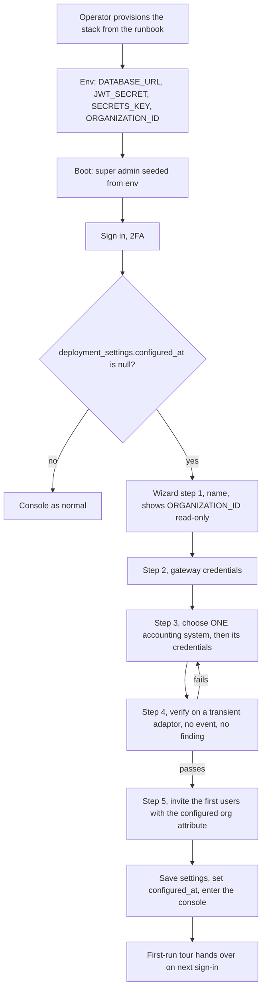

# Implementation Plan — Organization Onboarding (one deployment per organization)

**Item 1 of the onboarding workstream.**
**Direction decided (2026-09-24): one deployment per organization.**

**Branch:** `feat/org-onboarding`.
**Estimate:** **31–42 engineer-days** (~6–8.5 weeks solo, ~4–5 weeks with two engineers). Composition in §7.
**Supersedes** the multi-tenant plan committed at `14ab408` — that version remains in git history and its
multi-tenancy analysis is now an appendix of deleted work, not a live design.

---

## 1. What the direction changes

The tenancy axis disappears. The deployment *is* the organization, so:

| Removed | Why |
|---|---|
| `organizations` table, org CRUD API, org repository | There is exactly one organization, and it is the deployment |
| Per-organization adaptor registry keying, per-(org, adaptor) instance cache | One connection per adaptor per deployment — the existing global cache is already correct |
| Per-org runtime state (`lastKnownAdaptorStates` keyed by org) | Unchanged; the existing `Map<AdaptorId, …>` is the right shape again |
| `connectorState` rows per (org, adaptor) | Unchanged — one row per adaptor is right |
| Per-org webhook secret routing (`ClientId → org` before HMAC) | One secret per deployment |
| Organization switcher, multi-org shell policy model | No user belongs to two organizations that share a deployment |
| Cross-tenant isolation test suite | No second tenant exists in a deployment |

| Kept, and still required | Why |
|---|---|
| Deployment settings store + encrypted secrets | The wizard must persist configuration *somewhere*; it cannot be `.env` (§4 D2) |
| Credential injection into the adaptors | `QuickBooksAdaptor.connect()` reads `env.QUICKBOOKS_*` **directly** and `AccountingAdaptor.connect()` takes no credentials — still a breaking interface change (C3/C4) |
| The first-run wizard | This direction makes it the centerpiece rather than one phase |
| First-run gating, `ConfigPage` rewritten against a real API | Unchanged |
| Webhook signature verification restored | Still commented out; still a live gap |

| **Added by this direction** | Why |
|---|---|
| **Canonical organization identity from configuration** | §2 — the most important finding, and new |
| **A provisioning runbook + install automation** | One deployment per organization means N installs; a repeatable install procedure *is* the onboarding process (§6) |

> **Honest note on the estimate.** I previously put this path at 15–25 days. That was optimistic: it
> assumed the org identity work and the credential-injection change could be skipped, and it treated
> provisioning as out of scope. §7 shows the composition. The direction still saves roughly 10–18 days
> against the multi-tenant plan (41–60), mostly by deleting the registry/state refactor and the org
> switcher — it does not make this small.

---

## 2. ★ The finding that now leads the work

**The organization identity is hardcoded in production paths, and the invariant that makes it correct
is unenforced.**

| Where | Value | Kind |
|---|---|---|
| `services/webhooks/webhookProcessor.service.ts:40` | `private readonly organizationId = 'org-1'` | **hardcoded default**, constructor-injectable but never injected |
| `services/events/adaptorEventRecorder.service.ts:58` | `DEFAULT_ORGANIZATION_ID = 'org-1'` | hardcoded; its comment says it deliberately matches the processor |
| `services/adaptors/connectorState.service.ts:136` | `organizationIds?.[0] ?? '*'` | **invents `'*'`** as a stored `organization_id` when the caller holds a wildcard |
| `controllers/auth.controller.ts` `inviteBodySchema` | `organizationId: z.string().min(1)` | **free text supplied by the client** |
| `dashboard` / `failures` / `reports` / `payments` routes | `organizationId` from body/query | supplied by the client |
| `inMemory.ts` seed rows, demo fixtures | `'org-1'` for events, `'acme'` for policies | already inconsistent in fixtures |

**Why this is the lead item rather than a tidy-up.** Every operational row carries an
`organization_id`, and reads are filtered by `authorizedOrganizationIds(policy, scope)` — which returns
the org ids **named in the caller's policy attributes**. So the system is only correct while

> *the `organization_id` on every row equals an `organizationId` in the policy of every user who is
> supposed to see it.*

Nothing enforces that today. The rows are written under a hardcoded `'org-1'`; the policy attributes
come from a free-text field an administrator types at invite time. **If the two disagree, the user's
console is empty while the backend works perfectly** — and the person testing is almost always the
env-seeded super admin, whose `*/*` wildcard bypasses the filter entirely and therefore sees
everything. That is precisely the "silent console over a healthy backend" failure this product exists
to prevent, and it is invisible to the one account most likely to be looking.

Under one deployment per organization there is exactly one correct answer, and it should come from
configuration once:

- **`ORGANIZATION_ID`** — a deployment-scoped env var, alongside `DATABASE_URL` and `JWT_SECRET`,
  defaulted to a single documented value (`default`) rather than `'org-1'`, `'acme'` or `'*'`.
- Every default and fallback above resolves to it. `'*'` is a **policy wildcard and never a stored
  row value**.
- The wizard **shows it read-only**, so the id used for invites cannot drift from the id on rows.
- The invite path stops accepting an arbitrary `organizationId`: the wizard derives the attribute from
  the configured value, single-sourced.

This is a small amount of code and a large amount of correctness. It is Phase 1, before the wizard,
because the wizard's invites are one of the two things that can break the invariant.

---

## 3. Scope — three deliverables

| | Deliverable | Owner | Notes |
|---|---|---|---|
| **A** | **Provisioning runbook + install automation** | Vendor/operator | One deployment per org means this happens N times; it must be a documented, scriptable procedure, not tribal knowledge |
| **B** | **First-run wizard** (authenticated, gated on "not yet configured") | The org's administrator | Name, gateway credentials, accounting software (choose one) + credentials, verify, invite the first users |
| **C** | **Ongoing configuration** — `ConfigPage` against a real API | Org administrator | Change credentials, re-verify, change cadence, rotate secrets |

**Done means:** an operator provisions a stack from the runbook, signs in as the seeded super admin, is
routed into the wizard because the deployment is unconfigured, chooses QuickBooks *or* Sage, has the
connection verified before anything is saved, invites the first users, and sees live data on the
console — with the accounting adaptor they did *not* choose absent, not broken.

**Non-goals**

- Any multi-tenancy. No `organizations` table, no org switcher, no tenant routing.
- Ripping `organization_id` out of the schema. It stays, filtered as it is today, carrying one value —
  removing it is a large refactor that buys nothing and loses defence in depth.
- Fixing adaptor push/pull semantics. `QuickBooksAdaptor` and `SageAdaptor` both document those as
  approximate; onboarding establishes a *connection*, which is what the console reports.
- Fleet management across N deployments (upgrade orchestration, central monitoring). Raised in §12 as a
  consequence, not planned here.

---

## 4. Decisions

### D1 — One canonical organization id, configured once

Per §2. `ORGANIZATION_ID` in env (deployment-scoped, so it follows the same rule as `DATABASE_URL`),
defaulted, logged at boot, displayed read-only in the wizard, and used by every write path and every
generated policy attribute. The two hardcoded `'org-1'` defaults and the `'*'` fallback are deleted.

**Why env rather than wizard-set:** webhook and background paths need the id at boot, before any human
has interacted with the wizard, and they must not depend on a row that may not exist yet. The
organization's *display name* and its credentials are wizard-set; its *identity* is deployment config.

### D2 — Configuration lives in the database, not `.env`

The wizard runs against a live deployment (through nginx or the tunnel). Writing `.env` from the
application means file permissions, a container restart to re-read it, config drift from the running
process, and — because `config/env.ts` is zod-validated fail-fast at boot — a bad write that prevents
the API from starting. None of that is acceptable for a step an administrator performs.

So: a **single-row settings table** for everything the wizard and `ConfigPage` write, with secrets
encrypted. A small set of values must stay in env because they are needed to *reach* the database at
all: `DATABASE_URL`, `JWT_SECRET`, `SECRETS_KEY`, `TRUSTED_PROXY_HOPS`, `SMTP_*`, `APP_BASE_URL`,
`CORS_ORIGINS`, `ORGANIZATION_ID`.

The boundary is the thing future contributors will get wrong, so it goes in `server/AGENTS.md` as a
table when the work lands. Getting it wrong in the other direction means a secret in git.

### D3 — Encryption at rest, write-only over the API

| | |
|---|---|
| Storage | AES-256-GCM envelope encryption, key from `SECRETS_KEY` (env / AWS Secrets Manager per REQUIREMENTS §8), with a `key_version` column |
| API | `GET` returns **presence and last-4 only** (`configured: true`, `…-4f2a`). `PUT` writes. There is **no read-back** |
| Rotation | Writing replaces the ciphertext and bumps `key_version`; `SECRETS_KEY_PREVIOUS` allows decrypt-on-read during rotation |
| Non-negotiables | No secret in a log, an audit row, an error message, or a fixture. pino redaction extended to the new keys |
| Tests | Round-trip; wrong key; "GET never contains the value"; "the audit row records the event, not the value"; a failed verify never echoes the submitted credential |

### D4 — No new unauthenticated endpoint; the wizard is an authenticated page

An unauthenticated "set me up" route is a race-to-own-target: whoever reaches a fresh install first
owns it, and an `is-this-configured` flag is itself an enumeration oracle. The env-seeded super admin
already exists, is idempotent and is tested.

So the wizard is an ordinary authenticated route, gated on `deployment_settings.configured_at IS NULL`.
Nothing new is world-callable, and there is no window in which the system is unclaimed. (The public
`GET /health` keeps returning `{status:'ok'}` and nothing else — this repo asserts that shape
deliberately.)

### D5 — Adaptors take credentials; the adaptor stops reading `env`

Still required, and unchanged by the direction:

```ts
export interface AdaptorCredentials {
  clientId?: string; clientSecret?: string; baseUrl?: string;
  realmId?: string; accessToken?: string; refreshToken?: string;
}
export interface AccountingAdaptor {
  /** Credentials are SUPPLIED. The adaptor must not import `env`. */
  connect(credentials: AdaptorCredentials): Promise<void>;
  // …unchanged
}
```

Cheaper than the multi-tenant version: there is **one** instance per adaptor id, so the registry cache,
the runtime state map and the `connectorState` derivation all stay exactly as they are. The work is the
interface, the two adaptors, the gateway's webhook secret (same injection shape), and the test doubles.

**The refresh-token problem is worth naming** (it is in `QuickBooksAdaptor` today): Intuit rotates the
refresh token on every exchange, and the current code holds the rotated value **in the instance** and
falls back to the env value on restart — its own comment says so. Once credentials live in the DB, the
rotated token should be written back to the settings row, or every restart silently reverts to a spent
token and the connection dies after one token lifetime. **Decided (Phase 0): persist on rotation**, in
Phase 3 — the in-instance fallback also has no `.env` to hand-edit any more.

### D6 — Verify before save, and do NOT route it through the probe

The wizard's "Test connection" builds a **transient** adaptor via `createAdaptor()`, calls
`connect(credentials)` then `healthCheck()`, and persists only on success. It reuses the real error
taxonomy — and now also `AdaptorFailureReason` (`'auth' | 'rate-limited' | 'unreachable' | 'upstream'`,
added in `1072b63`), so the wizard can say "the provider rejected these credentials" rather than
scraping a message.

**Constraint:** the verify call must **not** go through `probeAdaptors()`. That path now files
lifecycle events through `AdaptorEventRecorder` (added in `1072b63`), so a mistyped credential during
setup would write an `adaptor-auth-failed` event and raise a finding — polluting the operator's own
findings list with the typo they are in the middle of fixing. Verify on a transient instance; the real
probe records state changes only after the credentials are saved.

### D7 — Only the chosen accounting software is active

The direction says each organization uses one accounting system. Today the registry registers **both**
adaptors unconditionally, and `connectorState.service.ts` derives a connection row **per registered
adaptor** — so a QuickBooks-only deployment displays a Sage row reading "Sage credentials are not
configured" (`SageAdaptor.connect()` throws exactly that message) and renders it as a suspended route
on the Connections page and the service map.

That is a fabricated-looking defect on the console's most important page. The fix is small and follows
from the choice being explicit: **register, probe and display only the adaptor named in the settings
row.** Where a deployment has chosen nothing yet (pre-wizard), the console should say so rather than
show two broken routes.

### D8 — Who may configure

Reuse the existing vocabulary. Configuration is the `system` scope's `admin` action — the
`SYSTEM_MANAGE` ability already gates `ConfigPage`, and `Can.tsx`/`Cannot` already implement
hidden-not-disabled. **No new permission concept**; at most one new `ABILITY` entry. Invites continue
through the existing `POST /auth/invite` with `assertGrantableByAdmin`, with the organization attribute
derived from D1 rather than typed.

### D9 — Re-verification and drift are part of the feature

Credentials expire (the QuickBooks access token is ~1 hour). `ConfigPage` therefore needs: last
verified timestamp, a re-verify control, and a clear statement of *which* failure it is. The adaptor
already distinguishes "not configured" from "configured but not authorized" — the console should stop
re-deriving that distinction and quote it.

---

## 5. Architecture

### 5.1 Data model — single row, enforced

`server/src/db/migrations/005_deployment_settings.sql` (004 is taken by `adaptor_events`):

```sql
CREATE TABLE IF NOT EXISTS deployment_settings (
  -- One row, enforced by the primary key rather than by convention.
  id boolean PRIMARY KEY DEFAULT true CHECK (id),
  organization_name text NOT NULL DEFAULT 'Unnamed organization',
  gateway_client_id text,
  gateway_webhook_secret_ciphertext bytea,
  adaptor_id text CHECK (adaptor_id IN ('quickbooks', 'sage')),
  adaptor_realm_id text,
  adaptor_base_url text,
  adaptor_credentials_ciphertext bytea,
  key_version smallint NOT NULL DEFAULT 1,
  sync_interval text,
  alert_target text,
  verified_at timestamptz,
  configured_at timestamptz,
  created_at timestamptz NOT NULL DEFAULT now(),
  updated_at timestamptz NOT NULL DEFAULT now()
);

INSERT INTO deployment_settings (id) VALUES (true) ON CONFLICT (id) DO NOTHING;
```

`configured_at IS NULL` is the first-run flag. One row means the wizard is an `UPDATE`, never an
insert-or-update race.

### 5.2 Wizard flow



### 5.3 API surface

| Method | Path | Gate | Notes |
|---|---|---|---|
| `GET` | `/api/v1/settings` | `system` `read` \| `write` \| `admin` | Presence + last-4 only. Includes `organizationId` (from D1) |
| `PUT` | `/api/v1/settings/gateway` | `system` `write` \| `admin` | Write-only credentials; throttled; audited |
| `PUT` | `/api/v1/settings/adaptor` | `system` `write` \| `admin` | Adaptor id + realm + write-only credentials; takes effect immediately |
| `PUT` | `/api/v1/settings/preferences` | `system` `write` \| `admin` | Organization name, sync cadence, alert target |
| `POST` | `/api/v1/settings/adaptor/verify` | `system` `write` \| `admin` | Transient probe; records no lifecycle event. Writes nothing it TESTED (D6) |
| `POST` | `/api/v1/settings/complete` | `system` `write` \| `admin` | Stamps `configured_at`; idempotent |
| `POST` | `/api/v1/webhooks/amber-pay` | public | Signature verification restored; secret injected from settings |

Every mutation throttled and audited. The webhook route must fail closed when no secret is configured
yet — which is a real window, since payments can arrive before the wizard is finished.

### 5.4 Files

**New — server**

```
db/migrations/005_deployment_settings.sql
models/deploymentSettings.ts
types/settings.ts
repositories/ (settings repository, inMemory + postgres)
utils/secrets.ts                     # AES-256-GCM + key versions
services/settings/settings.service.ts
services/settings/verify.service.ts   # transient probe, records nothing
controllers/settings.controller.ts
routes/settings.ts
```

**Changed — server**

```
types/adaptor.ts                       # connect(credentials) — breaking (D5)
services/adaptors/registry.ts          # activate ONE adaptor from settings (D7)
services/adaptors/{quickbooks,sage}.service.ts   # stop importing env; accept credentials
services/adaptors/health.service.ts    # probe the active adaptor only
services/webhooks/webhookProcessor.service.ts    # 'org-1' -> ORGANIZATION_ID (D1)
services/events/adaptorEventRecorder.service.ts  # same
services/adaptors/connectorState.service.ts      # '*' fallback -> configured id
services/gateway/amberpay.service.ts   # webhook secret injected, not env
controllers/webhooks.controller.ts     # restore verification (Phase 0)
controllers/auth.controller.ts         # invite org attribute derived, not typed (D1)
config/env.ts                          # + ORGANIZATION_ID, SECRETS_KEY, SECRETS_KEY_PREVIOUS
AGENTS.md                              # the env/DB boundary table (D2)
```

**New — web**

```
pages/onboarding/OnboardingPage.tsx + steps/*.tsx
services/settings.service.ts
utils/settingsRules.ts                 # validation shared by wizard and ConfigPage
```

**Changed — web**

```
pages/ConfigPage.tsx    # real API, re-verify, last-verified, presence-not-value
components/Shell.tsx    # first-run gating -> wizard; hand off to the tour
router.ts, utils/permissions.ts, types/api.ts, services/client.ts
```

---

## 6. Deliverable A — the install runbook

Under one deployment per organization, onboarding begins *before* the app is reachable, and this
direction makes that procedure a product artifact rather than tribal knowledge.

Contents (docs + a script that does the mechanical parts):

1. Prerequisites: host, Docker, DNS or tunnel, TLS termination.
2. Generate secrets: `JWT_SECRET`, `SECRETS_KEY`, database password — never reused across deployments.
3. `.env` from `.env.example`, with `ORGANIZATION_ID` set to the client's agreed id and `SMTP_*` for
   their mail.
4. `docker compose up -d --build`; confirm `GET /health` and the seeded super admin in the logs.
5. Postgres: confirm migrations applied, including the new numbered ones.
6. First sign-in → wizard → verified connection → first invites.
7. A short "handover" checklist: the organization id in writing, who holds admin, what was verified
   when, and how to rotate a credential.
8. **Upgrade path per deployment** — since migrations run on boot, the runbook must state the backup
   step before an upgrade and how to roll back.

Item 8 is the one that scales badly and is worth stating plainly: with N deployments, every schema
migration is an N-times operation performed by a human. That is the real cost of this direction, and
it is why the runbook is a deliverable rather than an aside.

---

## 7. Phases

| Phase | Work | Days |
|---|---|---|
| **0** | Confirm D1–D9. **Restore webhook signature verification** (live gap). Decide the refresh-token persistence question (D5). | 2–3 |
| **1** | **Canonical organization identity** (§2/D1): `ORGANIZATION_ID`, delete both `'org-1'` defaults and the `'*'` fallback, derive the invite attribute, audit every write path, boot log + test. | 3–4 |
| **2** | Settings store: migration 005, repository (both impls), service; `utils/secrets.ts`, write-only API semantics, key versions, audit events, logger redaction. | 4–5 |
| **3** | Credential injection (D5): `connect(credentials)` on both adaptors, gateway webhook secret, injection from settings, test doubles. | 3–4 |
| **4** | Only the chosen adaptor is active (D7): register/probe/display one, fix the phantom Sage row. | 1–2 |
| **5** | Settings API (D3/D6): routes, PBAC gates, throttling, audit, transient verify. | 3–4 |
| **6** | Wizard UI: 5 steps, per-step validation, error summary, resume, verify with classified reasons. | 6–8 |
| **7** | First-run gating, Shell wiring, `ConfigPage` against the real API, tour hand-off. | 2–3 |
| **8** | Provisioning runbook + install script + `.env.example` updates (deliverable A). | 3–4 |
| **9** | Tests: secrets non-exposure, identity invariant, verify-does-not-pollute, webhook fail-closed, wizard validation. | 4–5 |
| | **Total** | **31–42** |

### Progress

**Phase 0 — done.** Webhook signature verification **restored** in
`controllers/webhooks.controller.ts`. The suite went from 2 failing cases to 0; those two were the only
failures in the repository. Refresh-token persistence decided (see D5).

**Phase 1 — done.** `ORGANIZATION_ID` added to `config/env.ts` (default `default`), wired through
`docker-compose.yml` and both `.env.example` files, set to `org-1` in `src/test/setup-env.cjs` so the
existing tests keep their meaning, and logged at boot in `server.ts`. The three invented ids are gone:

| Before | After |
|---|---|
| `webhookProcessor` — `organizationId = 'org-1'` | `= env.ORGANIZATION_ID` |
| `AdaptorEventRecorder` — `DEFAULT_ORGANIZATION_ID = 'org-1'` | `= env.ORGANIZATION_ID` |
| `connectorState` — `organizationIds?.[0] ?? '*'` | `?? env.ORGANIZATION_ID` |
| Invite + `PATCH /users/:id` grants — any org accepted | the canonical org or `'*'`; anything else is **400** |

Tests added: the `'*'`-fallback regression, a wildcard-grant allowance (which guards the new rule
against over-reach), and the updated foreign-organization case.

**One deliberate behaviour change, worth knowing before it surprises anyone:** a grant naming a foreign
organization was previously refused by the *escalation guard* with **403**, and is now refused by the
*canonical-organization rule* with **400**. The escalation guard is unchanged and still covers the
same-organization case, so no coverage was lost — but a client asserting 403 on that exact path would
now see 400.

Suite after Phase 0+1: **316 passed / 5 skipped / 0 failed** (from 312 / 5 / 2).

**Phase 2 — done.** The settings store and credential encryption.

- `db/migrations/005_deployment_settings.sql` — the single row, enforced by
  `id boolean PRIMARY KEY DEFAULT true CHECK (id)`. One row means the wizard is an `UPDATE` and never an
  insert-or-update race.
- `utils/secrets.ts` — AES-256-GCM in a **self-describing envelope**:
  `[version][nonce][auth tag][ciphertext]`. The key version travels *inside* the value rather than in a
  sibling column, because one column cannot describe two credentials written under different keys during
  a rotation. **This supersedes the `key_version` column in §5.1.**
- `config/env.ts` — `SECRETS_KEY` (64 hex chars, optional), `SECRETS_KEY_VERSION`, `SECRETS_KEY_PREVIOUS`,
  and a `blankAsAbsent` preprocess (see the trap below).
- `services/settings/settings.service.ts` — the write-only projection
  (`configured` / `lastFour` / `unreadable`), validation at the one boundary every write crosses, and a
  deliberately conspicuous `resolveCredentials()` that is server-side only.
- `organizationId` in the read model comes from `env.ORGANIZATION_ID`, **not** from the row: two copies
  of an identity are two chances to disagree. **This supersedes the `organization_id` column in §5.1.**
- 28 tests added. The load-bearing ones: the stored **bytes** contain no plaintext (not merely that the
  projection hides it), a real rotation case that hand-builds an older envelope and reads it with the
  previous key, and "an unreadable credential is reported, not thrown" — one bad row must not take out
  the whole settings read.

**Trap worth keeping:** docker-compose renders `${VAR:-}` as an **empty string**, and zod treats a
present-but-empty value as a value. Adding a format check to an optional variable therefore makes every
deployment that leaves it blank fail to boot. Hence `blankAsAbsent`. This would have broken the stack on
the next rebuild, and it is the kind of thing that only shows up outside the test suite.

Suite after Phase 2: **344 passed / 5 skipped / 0 failed** (from 316).

**Phase 3 — done.** Adaptors take their credentials; nothing inside an adaptor reads `env`.

- `types/adaptor.ts` — `AdaptorCredentials`, `ConnectResult`, and `connect(credentials)` is now
  **required**. `ConnectResult.rotated` exists because Intuit invalidates a refresh token as it spends
  it: a caller that does not persist the replacement presents a spent token on the next start, one
  token-lifetime after every restart, which reads as flakiness rather than as a bug.
- Both adaptors hold the credentials they were given and reference the environment nowhere. Each keeps
  its own default base URL, so an absent `baseUrl` is a working connection rather than an empty string.
- `services/adaptors/credentials.provider.ts` (new) — the ONE place that bridges stored configuration to
  `connect`. **Stored first, environment second; the second half is transitional.** A deployment
  configured entirely from `.env` keeps working unchanged — sandbox base URL, hand-pasted token and all
  — while the wizard takes ownership. Deleting the fallback before the wizard can set every field would
  break every existing install on upgrade, which is a worse failure than two sources for a while.
  `connectAdaptor()` is the single entry point, so no call site can connect with credentials that
  skipped the provider or drop a rotation on the floor.
- `registry.reset(id)` — **MUST be called when credentials change.** `get()` caches one instance per
  adaptor id, and that instance remembers both the credentials it connected with and a rotated refresh
  token; without a reset, saving new credentials leaves the console reporting the old failure and the
  operator re-enters a correction that was never used. *Phase 5's settings write is the caller.*
- The gateway's webhook secret is injected on the same principle, with the environment as fallback, and
  the controller resolves it per delivery (one indexed single-row read — caching it in the process is
  what made a credential change need a restart in the first place).
- 6 tests added. The decisive one: **`connect({})` fails even though `setup-env.cjs` sets
  `QUICKBOOKS_CLIENT_ID` and `SAGE_CLIENT_ID`** — an adaptor that still consulted the environment would
  connect there. Also covered: the supplied base URL and realm win, and a 401 does not retry without a
  refresh token (retrying would re-present the same expired token).

Suite after Phase 3: **350 passed / 5 skipped / 0 failed** (from 344).

**Gap deferred to Phase 5, stated so it is not mistaken for done:** `credentials.provider.ts` resolves
through the `settingsService` singleton rather than an injected dependency, so the *stored*-credentials
branch cannot be unit-tested until the settings write API exists to seed it. Today it is exercised only
on the environment-fallback branch. Phase 5 must add a test that stores credentials and asserts the
provider prefers them.

**Phase 4 — done.** A deployment integrates with **one** accounting system, chosen at setup.

- **The failure this fixes is a phantom.** An unrestricted registry drew a second, suspended route on a
  QuickBooks-only console reading *"Sage credentials are not configured"* — nothing was broken, but an
  operator is handed a fault to chase that does not exist, on the page that matters most.
- `registry.isActive(id)` / `setActiveAdaptorId(id)` / `activeAdaptorId()` (new). The distinction that
  was missing is between *which adaptors exist* and *which one this deployment uses*: **`list()` stays
  the full catalogue** — it is the choice the wizard offers — and everything that probes, displays or
  pushes to a *connection* filters on `isActive()`. A registry that was never activated is
  **unrestricted**, meaning null is not "none": boot is the one place that restricts it, and no existing
  caller changes behaviour by accident.
- `services/adaptors/activeAdaptor.service.ts` (new) — `resolveConfiguredAdaptorId()` (**stored choice
  first, environment second**, the same transitional shape as the credential fallback) and
  `syncConfiguredAdaptor()`, which restricts the registry and **resets the newly active adaptor** when
  the choice changes — its cached instance holds the credentials it connected with, including a rotated
  refresh token, so carrying it across a switch reports the previous system's failure.
- Restricted at three surfaces, which is every way an accounting system can be observed: the **probe**
  (no finding is filed for a system this deployment does not use), the **connection list** (no derived
  row, and a *stored* row attributable to the other system is dropped as stale — rows whose terminus is
  not an adaptor pass through untouched), and the **push target**.
- The processor no longer guesses. `activeAdaptorId` became an explicit **test-only override** with no
  default, and the push path resolves from configuration per delivery, so a Sage deployment stops
  pushing its completed payments to QuickBooks. With nothing configured it **throws
  `AdaptorConnectionError`** rather than guessing: a completed payment with nowhere to go is a real
  operational failure, and the existing catch files it as a critical Failure instead of letting the
  event look processed and vanish.
- **R2 was still live, in the very file this plan exists to fix.** The `webhookProcessor` singleton
  passed `'quickbooks'` *and* `'org-1'` as explicit arguments, and an explicit argument **beats a
  default parameter** — so Phase 1's configured-organization default was defeated for the actual
  production singleton, and every row it wrote was invisible to the organization that owned it, with no
  error anywhere and a wildcard super admin as the only reader. Both literals are gone; `undefined` is
  passed explicitly for the adaptor so the shared dedup repository keeps its position (omitting it would
  silently substitute a throwaway in-memory one and break deduplication across restarts).
- 11 tests added, and the number that matters is not the count but that **the filter had none before**:
  the suite was green and unchanged when this phase landed, because every existing test used the
  unrestricted default. Added: the phantom row asserted **before and after** restriction (so the test
  states the defect, not just the fix); the chosen system still reported on the *failure* path; a stored
  row of the other system dropped while a non-adaptor row survives; the unchosen system never contacted
  by a probe; and **the singleton's records filed under the configured organization** — asserted by
  re-importing it against an overridden `ORGANIZATION_ID`, which is the only shape that would have
  caught the original bug, since the test suite's own value is the same `'org-1'` literal.

Suite after Phase 4: **361 passed / 5 skipped / 0 failed** (from 350).

**Phase 5 — done.** The settings API: `routes/settings.ts`, `controllers/settings.controller.ts`, and
`services/settings/verify.service.ts` (new).

- **The gate is one idea with two spellings.** New `requirePolicyAnyAction` in
  `middleware/auth.middleware.ts`. The console identifies an operator who may manage this deployment
  with `SYSTEM_MANAGE` — `system.write` OR `system.admin` — and two gates in sequence would require
  BOTH, so an administrator holding only `admin` would be refused a control the console had just
  invited. Reads take `read` too (a read-only system holder renders the page with locked controls, so
  the page must be *fetchable* or it renders empty for the one person who should see it); writes take
  `write` or `admin`.
- **The PBAC resource is FIXED** — `system` for `env.ORGANIZATION_ID` — and not read from the request.
  There is no parameter to tamper with in order to reach another deployment's configuration, and a
  system administrator of a *different* organization is refused (asserted).
- **Mutations are throttled at 30/15min; verification separately at 10/15min**, because it is the one
  settings call whose cost a third party pays. Sharing the budget would let a console left open burn an
  accounting provider's rate limit with retries.
- **Every mutation schema is STRICT, so a misspelled key is a 400.** Zod strips unknown keys by
  default, which answers "saved" to a request that changed nothing — worse than an error, because the
  operator's next move is to leave believing it worked.
- **Verify honours D6, and the one deviation is deliberate.** It builds a TRANSIENT instance with
  `createAdaptor()` and never `get()`: `get()` returns the instance production connects, probes and
  pushes through, so trying a mistyped credential against it would replace a working connection with a
  broken one — the wizard would damage the thing it was asked to check. Proved by test (the live
  instance is untouched and not reset). It also files **no lifecycle event and no finding**, which is
  the R4 mitigation: a typo being corrected must not look like an outage.
  The deviation: the table above says "persists nothing", and the STORED mode does write. SUPPLIED
  credentials (the wizard, before saving) record nothing at all; STORED credentials (the console's
  re-verify) stamp `verifiedAt` and persist a rotation. Without that, `verifiedAt` could never be
  refreshed, and discarding a rotation there would kill the connection on the next restart one token
  lifetime after a screen that said "healthy" (R5).
- **A failed verification is a 200 with `ok:false` and a classified `reason`.** A rejected credential is
  the expected result of an operator typing one, so it is an answer rather than a transport failure,
  and the wizard needs the reason to distinguish "fix the value" from "try again later".
- **A saved adaptor configuration takes effect immediately** — `syncConfiguredAdaptor` then
  `reset(activeId)` — or the operator watches a correction change nothing and enters it again.
- **Two defects the new tests caught while being written:**
  1. **`complete()` was not idempotent.** A reloaded wizard, a retried request or a double-clicked
     Finish rewrote when the deployment was configured. It now reads before it writes; the test covers
     the promise the plan had already made.
  2. **`resolveConfiguredAdaptorId()` read the module singleton while the route used an injected
     service** — so a WRITE could land in one settings row while the active accounting system was
     decided from another. It now takes the reader explicitly. This is the same hidden-coupling shape
     as the Phase 3 gap below, and it is why the provider file's fix is structural rather than a test
     workaround.
- Also: a credential write on a deployment with no `SECRETS_KEY` returned a **500 from inside
  `sealSecret`**, which reads as a bug in the API rather than as one missing environment variable. Now
  a 503 naming the command that fixes it. *Untested — the suite has a key; worth a case when the env
  schema gains a seam.* An orphaned doc comment that described credential-change clearing had come to
  rest above `complete()`; it is back on `clearVerification`, which it describes.
- 24 tests added (17 route, 7 provider). Suite after Phase 5: **385 passed / 5 skipped / 0 failed**
  (from 361). `db/seed.test.ts` also gained `jest.setTimeout(30_000)`: under the now-larger suite it
  failed on CPU contention (bcrypt cost 12) while passing alone, and the repo already carries exactly
  this remedy in `accounts.test.ts`. A red baseline that is really a timeout misleads the next person.

**The Phase 3 gap is now CLOSED.** `services/adaptors/credentials.provider.test.ts` (new) exercises the
stored branch that had none: a stored credential beats the environment (asserted against a non-empty
environment, so precedence is what is proven); the merge is per field, so a partially filled set still
connects; one system is never handed the other's credentials; an **undecryptable** stored row falls
back to the environment instead of crashing the probe; a rotation is written back to the row; and a
rotation that arrived on an ENVIRONMENT fallback does **not** invent a stored credential set.

**Phase 6 — done, with one gap stated.** The wizard: `web/src/pages/onboarding/OnboardingPage.tsx`,
`web/src/components/onboarding/Stepper.tsx`, `web/src/utils/settingsRules.ts` (new). Changed:
`router.ts`, `components/Shell.tsx`, `services/client.ts`, `types/api.ts`, `components/ui.tsx`.

- **A defect in the phase that had just shipped, found before this one started.**
  `POST /settings/adaptor/verify` returned the service's whole result, including `rotated` — which in
  STORED mode is a refresh token **just minted from the sealed column**. The endpoint was publishing a
  stored secret, the one outcome this entire surface exists to prevent, and Phase 5's own tests passed
  it because they asserted the write-only rule on the gateway path only. Fixed with an explicit
  field-by-field projection (not an omit-rest idiom, so a field added to the service type later cannot
  be published by accident) and pinned by a test asserting the response has no `rotated` and does not
  contain the value.
- **Route `#/onboarding`, outside the console chrome**, for the same reason the auth surfaces are: a
  deployment with no gateway and no accounting system has no pipeline to monitor, so framing setup as a
  console page would wrap it in panels that cannot yet be true.
- **Resume is derived from the SERVER** (`firstIncompleteStep`), not from a browser draft. What the
  deployment actually has configured is the honest answer to "where was I", it is the same answer from
  another machine, and it cannot disagree with the row the wizard is writing to.
- **The stepper is navigation**: an ordered list, `aria-current="step"`, a button for every step the
  operator has validated, and plain text beyond that — not disabled buttons, because a disabled control
  promises an action the wizard cannot honour. The whole path stays visible from step one.
- **Fields are generated from `ADAPTOR_CHOICES`**, so a third accounting system remains a data change.
  An either/or requirement (QuickBooks needs a client id and secret to identify the app but a token to
  authorize a call) is reported once, in the adaptor's own terms rather than as a generic failure.
- **Deviation from §5.2, deliberate: a failed test does not trap the operator.** "Continue unverified"
  is offered as a visibly secondary action beside the warning. The alternative makes a briefly
  unreachable provider render the wizard unpassable, and not blocking access to the product is
  onboarding's first principle.
- **The secret fields do not fight password managers**: reveal toggle, paste allowed, no
  read-only-until-focused trick. `autoComplete="off"` declines to invite a manager to save a value that
  is not a credential for this site, and nothing further.
- **Two defects the render found, both fixed:** a signed-out `#/onboarding` returned `null` — a **blank
  page**, which is worse than asking somebody to sign in; and the "door or room" predicate was written
  twice (the document title and the render decision) and the two disagreed the moment this route
  existed. It is now one `needsSession` predicate in the component body — which is also where the first
  render threw `ReferenceError: needsSession is not defined`, because it had been defined inside the
  effect that reads it, while a render below needed it too.
- **Verified:** web typecheck, build clean, `audit:classes` **UNRESOLVED 0**, and — because the audit
  cannot see classes inside a `const` or `cx(...)`, which is exactly where a state-driven wizard puts
  them — every class introduced that way checked by name against the compiled CSS (44 classes, none
  missing). Routing and the sign-in gate verified live at `localhost:5199`.
- **NOT verified, and not to be mistaken for verified: the wizard's own rendering.** It needs a live API
  and a session, and walking the form would write settings into the real deployment, so it was left
  alone deliberately. The first visual pass belongs on a throwaway stack, and §10's checklist (stepper
  semantics, error-summary focus, the three verify states, reduced motion) is the list to walk it
  against.

### Critical path

**Phase 1 → 3 → 5 → 6.** Phase 1 is small but gates the wizard's invites. Phase 3 gates the verify
endpoint and therefore the wizard's most important step. Phases 2 and 8 run alongside. Phase 6 can be
built against a stubbed API while Phase 3 lands — that is the main opportunity to compress with a
second engineer.

### Coordination risk (see §12 R1)

Phase 3 touches `services/adaptors/*` and `types/adaptor.ts`, which **another writer modified
yesterday** (`1072b63`: `health.service.ts` +206, `sage.service.ts` +24, `errors.ts` +35,
`types/adaptor.ts` +12). Land Phase 1 and 2 first, and coordinate before starting Phase 3.

---

## 8. Testing

Beyond the existing suites, five tests are load-bearing:

1. **The identity invariant.** Every operational row written by every path (webhook, adaptor event,
   payment, acknowledgement) carries `ORGANIZATION_ID`; and a user whose policy names that id can read
   them. This is the regression test for §2 and the one that would have caught it.
2. **Secret non-exposure.** No `GET` contains plaintext; the audit row for a credential change contains
   no value; an adaptor error message contains no credential; a failed verify echoes nothing.
3. **Verify does not pollute.** A failed `POST /settings/adaptor/verify` writes **no** lifecycle event
   and raises **no** finding (D6).
4. **Only the chosen adaptor exists.** With `adaptor_id = 'quickbooks'`, no Sage row, no Sage probe,
   no Sage entry in the service map (D7).
5. **Webhook fails closed** with no secret configured, and verifies against the configured secret once
   set.

Baseline to preserve: **312 passed / 5 skipped / 0 failed** after Phase 0 removes the 2 pre-existing
webhook failures.

---

## 9. Security and privacy

| Requirement | How |
|---|---|
| Secrets never at rest in plaintext | AES-256-GCM, key versions (D3) |
| Secrets never returned | Write-only; presence + last-4 (D3) |
| Secrets never logged | pino redaction extended; audit records the event, not the value |
| No unauthenticated configuration surface | Env-seeded admin; wizard is authenticated (D4) |
| Webhook fails closed | Verification restored (Phase 0), then secret injected from settings |
| Rotation supported | `key_version` + `SECRETS_KEY_PREVIOUS`; re-verify control in `ConfigPage` |
| PRIVACY UNCHANGED | No amounts, no currency, no customer PII, no card data — in credentials, audit rows, error messages or fixtures. `models/privacy.test.ts` extended to the new types |
| Least privilege | All settings routes behind `SYSTEM_MANAGE` |

---

## 10. Wizard UX and accessibility

A five-step form on a dark console. The bar set by the tour work applies.

- **A stepper is navigation**, not decoration: an ordered list, `aria-current="step"` on the active
  step, every step keyboard-reachable, and a way back from every step.
- **Never a bare "Save" beside a credential field.** Validate on submit; the error summary is focusable
  and announced; each field is linked to its error by `aria-describedby`.
- **"Test connection" has three states** — idle, testing (announced politely), and a result phrased in
  the adaptor's own vocabulary: "the provider rejected these credentials" vs "the provider could not be
  reached" vs "configured but not yet authorized". Never a raw provider string.
- **Do not fight password managers** on the secret fields.
- **The organization id is shown read-only** with a one-line explanation of why it cannot be edited
  (D1) — an uneditable field that looks editable is worse than no field.
- **Honest empty and error states.** Until configured, the console says the deployment is unconfigured;
  it does not render a plausible-looking example. `ConfigPage`'s existing empty state is the precedent.
- **Reduced motion** needs no new work: the global rule collapses durations.

---

## 11. Verification gates

```bash
cd server && npm run typecheck && npx jest      # 312 passed / 5 skipped / 0 failed after Phase 0
npm --prefix web run build
npm --prefix web run audit:classes              # UNRESOLVED 0
```

Repo-specific traps:

- **`audit:classes` cannot see classes inside `cx(...)` or in a `const`** — a wizard with state-driven
  step styling lands exactly there. Confirm by grepping the compiled CSS (`grep -F`), remembering that
  Tailwind normalises `rgb()` literals to hex + alpha so a source-text grep finds nothing.
- **Never pipe a Node process's stdout in this shell** ("stdout is not a tty"), including
  `node scripts/audit-classes.mjs`.
- **Clear leaked env vars before trusting a jest run** if `.env` was ever sourced into the terminal.
- **The web image builds from source**: `docker compose up -d --build web`, then cache-bust.
- **A second writer is active in this workspace.** Re-verify your edits survived before trusting a
  green build.

---

## 12. Risks

| # | Risk | Severity | Mitigation |
|---|---|---|---|
| R1 | **Editing the same files as the concurrent writer.** Phase 3 rewrites `services/adaptors/*` and `types/adaptor.ts`, which changed yesterday. A conflict here could silently revert their adaptor-event work. | High | Land Phases 1–2 first; coordinate before Phase 3; re-run the full suite and inspect `git status` before and after. |
| R2 | **The identity invariant is broken for one deployment** (§2) and the console reads empty while the backend is healthy — invisible to the wildcard super admin. | High | Phase 1 before anything else; test §8.1; show the id in the wizard. |
| R3 | **A secret reaches git or the logs.** `.env` is ignored and `.env.example` holds only placeholders today, but credentials move *into* the DB, so the new exposure is the API and the log. | Critical | D3 + §8.2. |
| R4 | **The wizard's verify pollutes findings** with the typo being fixed, because the probe path now files lifecycle events. | Medium | D6: transient instance, never `probeAdaptors()`. Test §8.3. |
| R5 | **A restart silently kills the QuickBooks connection** because the rotated refresh token lived only in the instance (D5). | Medium | Decide in Phase 0; prefer persisting the rotated token to the settings row. |
| R6 | **N deployments, N migrations, done by hand.** Every schema change is a human operation repeated per client. | Medium | §6 item 8: backup + upgrade + rollback in the runbook. Fleet automation is out of scope and should be a conscious deferral. |
| R7 | **`ConfigPage` ships as theatre again** — a wizard writing real settings beside a Save button that does nothing. | Medium | Phase 7 rewrites it against the real API; until then it keeps saying it has no configuration source. |
| R8 | **Removing `organization_id` filtering** because "there is only one org". | Low | Keep the columns and the filtering; it is defence in depth and costs nothing. |

---

## 13. Definition of done

- [ ] An operator follows the runbook and reaches a working deployment, with `ORGANIZATION_ID` set and
      logged at boot.
- [ ] Every row written by every path carries that id, and a user invited with it can read them — proven
      by test, not by inspection.
- [ ] The wizard is reachable only when authenticated and unconfigured, and there is no new
      unauthenticated endpoint anywhere.
- [ ] The accounting system is chosen once; only that adaptor is registered, probed and displayed, and
      no phantom row for the other appears anywhere.
- [ ] The connection is verified **before** it is saved; a failed verify writes no event and raises no
      finding.
- [ ] No endpoint ever returns a secret; no secret appears in a log, audit row, error message or fixture.
- [ ] The webhook verifies signatures and fails closed when unconfigured.
- [ ] `ConfigPage` reads and writes real configuration, and shows presence — never the value.
- [ ] `npx jest` 0 failed · `tsc --noEmit` clean · `web` build clean · `audit:classes` UNRESOLVED 0.
- [ ] The env/DB boundary (D2) is documented in `server/AGENTS.md`.

---

## 14. Open questions

1. **Is the payment gateway credential per-organization or vendor-level?** If every client shares one
   Amber Pay merchant account, the gateway fields belong to deployment env, not the settings row, and
   Phase 5 shrinks. This is the largest remaining scoping question.
2. **Refresh-token persistence** (D5/R5): persist the rotated token to the settings row, or accept the
   restart cost?
3. **Who performs the wizard** — Amber Innovations staff during handover, or each client's own
   administrator afterwards? This changes the runbook's last step and whether the wizard needs an
   "assisted setup" mode.
4. **Does `ORGANIZATION_ID` need to be stable forever?** If a client's id ever changes, every stored row
   and every policy attribute must move together — worth either forbidding the change or planning a
   rename migration.
5. **Is per-client fleet management (upgrade orchestration, central monitoring) expected within 12
   months?** If yes, the provisioning script should be written with that in mind from Phase 8 rather
   than retrofitted.
